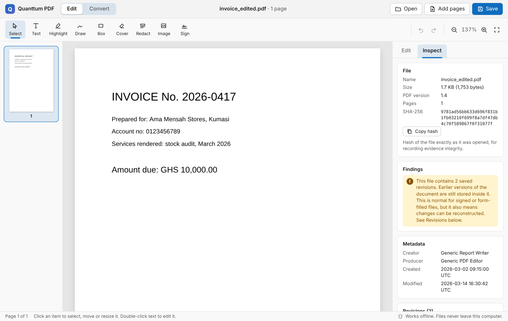
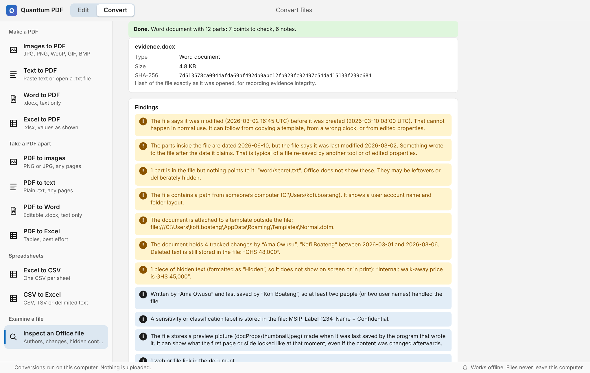
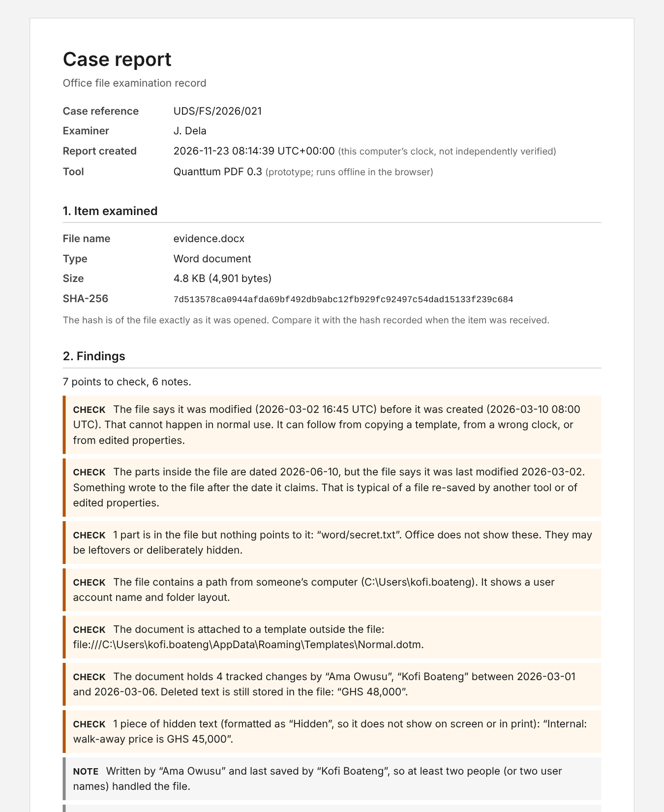
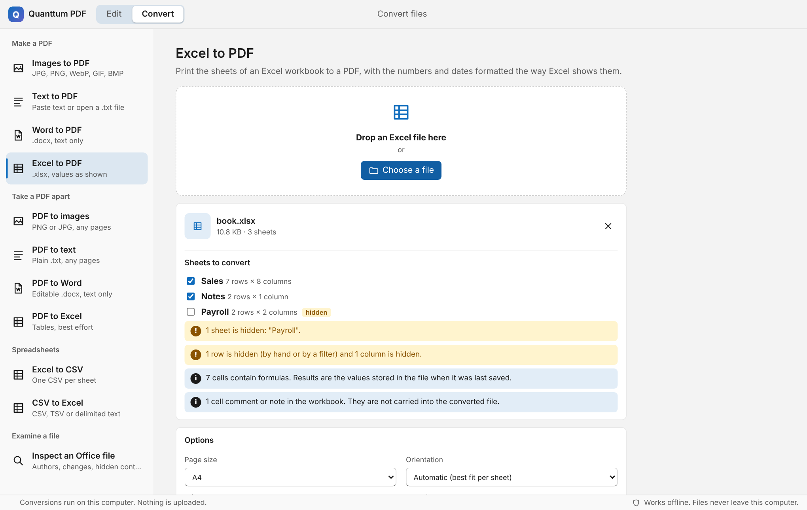

# Quanttum PDF

An offline PDF **editor, converter and file examiner** with a clean, Windows-11-style interface, built around three things most PDF tools get wrong:
**redaction that really removes the data**, **showing you what is hidden inside a PDF**, and **conversions that do not leak photo metadata into the PDF**.

Status: **working prototype**. The features below are implemented and tested. The limitations section lists what is not.



| | |
|---|---|
|  |  |
| *Office inspector: the deleted price, hidden text and a template path, all read from the file.* | *Case report: hashes, findings, every revision with its own hash, and a session log.* |



## Run it

1. Install Python 3 if you do not have it (python.org).
2. Double-click **`start.bat`** (Windows), or run `python server.py` in a terminal.
3. Your browser opens at `http://127.0.0.1:8765`. Use **Edit** to work on a PDF, or **Convert** to change formats.

No internet is needed, no account, no build step, no npm install. The two libraries it uses are vendored in `lib/`.
A small local server is needed only because browsers will not start the PDF engine's background worker from a `file://` address.
Nothing is uploaded anywhere: every conversion runs inside your browser on your computer.

Try `samples/invoice_edited.pdf`: it looks like a plain invoice for GHS 10,000.00, but the **Inspect** tab shows it was edited after it was created.

## Edit mode

**Mark up**
- Text, highlight, freehand drawing, boxes, images, and a drawn signature (kept only in your browser)
- Select, move, resize, delete; undo and redo (Ctrl+Z / Ctrl+Y)
- Pages: thumbnails with drag-to-reorder, rotate, delete, insert blank page, add pages from another PDF
- Save writes the marks into the pages (flattened)

**Redact (the part that matters)**
- *Cover* draws a white box. The text underneath is still in the file, and can be copied out. The tool says so.
- *Redact* removes the content. On save, each page with a redaction box is re-rendered as a picture with the black boxes burned in, so the covered text, vectors and annotations no longer exist in the file.
- After saving, the app re-opens its own output and checks that none of the redacted text can be found in the text layer or in the raw bytes. If any is found, it refuses to download.
- Trade-off, stated plainly: a redacted page loses its text layer (not selectable or searchable). Other pages are untouched.
- Mark-ups drawn underneath a redaction box are removed with it. Anything drawn after the box (for example a "REDACTED" label) is kept.

**Inspect (forensic details that viewers skip)**
- **Hidden revisions.** A PDF saved with "incremental save" keeps every earlier version inside the file. The scanner finds each one (only counting `%%EOF` markers that follow a real `startxref`, so stray bytes are not miscounted, and handling the two-EOF layout of linearized files). You can compare any revision with the previous one (text diff) or open it as its own document.
- **Producer and date per revision**, with a flag when the producing software changed between saves.
- **Metadata consistency:** modification date before creation date, dates in the future, Info vs XMP disagreement.
- **Data after the final `%%EOF`**, which viewers ignore.
- **SHA-256** of the file as opened and of every file you save.
- Findings are prompts for a closer look, not verdicts. Multiple revisions are normal for signed or form-filled files, and a clean result is not proof of authenticity.

**Case report**
- *Export case report* (Inspect tab) downloads one self-contained, printable page: the item's SHA-256, findings, document metadata, every revision **with its own SHA-256** (the file from byte 0 to that revision's `%%EOF`, so an extracted revision can be checked against the report), any data after the final `%%EOF` with its hash, and a log of what was done in the session (files opened, saved and converted, each with source and output hashes, including the redaction re-check result).
- Optional case reference and examiner fields, a signature line, and a plain statement of what the report does not prove. Open it in a browser and use Print to make a PDF.
- The page has no scripts and no external resources, and everything taken from the examined file is escaped, so a hostile file name or metadata value cannot change the report.
- Honest limits: the time stamps come from the computer's clock, the log lives only in the open browser tab (export before closing it), and the tool is a prototype that has not been validated as forensic software. The report says so.

**Save options**
- The saved file is rebuilt from scratch as a single clean revision. Earlier revisions and XMP packets are not carried over.
- Optional: remove document metadata entirely.

### Digital signature check (Inspect tab)
A green tick in a PDF viewer hides the useful questions. For each signature the tool shows which bytes it covers, whether anything was **added after** signing (a later revision), whether the covered bytes still hash to the value that was signed, whether the RSA signature verifies against the certificate stored in the file, the signer and certificate dates, and whether the padding after the signature holds hidden bytes. Several signatures in a row are explained as normal countersigning.
**It does not check** that a certificate is trusted or chains to an authority, whether it was revoked, who the signer really is, or ECDSA and RSA-PSS signatures. Test files are signed with pyHanko and compared with poppler's `pdfsig`.

## Convert mode

Ten conversions and one inspector, each with a page range or options where they make sense. Every result shows its **SHA-256** and, where there is a source file, the source's SHA-256 too, so the chain from original to converted copy is recorded.

| From | To | Notes |
|---|---|---|
| Images (JPG, PNG, WebP, GIF, BMP, AVIF) | PDF | One image per page; A4, Letter or same-size-as-image pages; reorder before converting |
| Text (paste or .txt) | PDF | Font, size, margins, page numbers; a form-feed character starts a new page |
| Word (.docx) | PDF | Text, headings, bold paragraphs, bullet lists, tables, page breaks |
| PDF | Images | PNG or JPG, 72 to 300 dpi, any pages; several pages come back as a zip |
| PDF | Text (.txt) | Keep the PDF's line breaks, or join lines into paragraphs; optional page markers |
| PDF | Word (.docx) | Headings and paragraphs rebuilt from font size and spacing; page breaks kept |
| Excel (.xlsx) | PDF | Values as Excel shows them (number and date formats, bold, alignment, fills, wrapping, column widths); shrink wide sheets or continue them on more pages; header row repeats |
| Excel (.xlsx) | CSV | One CSV per sheet (a zip if several); exact or as-displayed values; any separator; optional BOM |
| CSV | Excel (.xlsx) | Real numbers and dates, header row bold, frozen and filtered; separator and text encoding detected |
| PDF | Excel (.xlsx) | Finds columns in text-based PDFs, types the figures, merges repeated header rows; best effort |

### Inspect an Office file (Convert mode, "Examine a file")

Opens a `.docx`, `.xlsx`, `.xlsm` or `.pptx` as the zip of XML parts it is, without starting Office and without running any macro, and reports what the program would not show:

- **Who and when:** author, last saved by, created/modified/printed dates, revision number, total editing time, the program that wrote it, company, template, custom properties (including sensitivity labels). Flags a file that claims to be modified before it was created, or in the future, or whose parts are dated well after the date it claims.
- **Word:** tracked changes by person and date, **the text that was deleted** (still stored in the file), inserted text, hidden text, comments with their authors, how many editing sessions Word recorded (rsids), people listed as collaborators, the template path.
- **Excel:** hidden and very-hidden sheets, hidden rows and columns, cell comments, sheet and workbook protection, links to other workbooks, and **text stored in the workbook that no cell uses any more** (leftovers of deleted cells).
- **PowerPoint:** hidden slides with their text, **speaker notes**, comment authors.
- **The container:** parts nothing points to, duplicate part names, **bytes after the end of the zip** (with their own SHA-256), a macro project, embedded objects, a stored preview picture, paths from someone's computer (`C:\Users\name`), and links to places outside the file.
- Everything can be exported as the same style of printable **case report** as the PDF inspector, and the activity log is shared, so one report lists the PDFs and Office files examined in the session.
- Honest limits: only the modern formats (no `.doc`, `.xls`, `.ppt`, no password-protected files); property values can be set to anything; a finding such as an unreferenced part or a late part date is a reason to look closer, not proof of tampering. Plain regex reading of the XML, so unusual files may be missed. Every finding quotes what it found in the file so you can check it yourself.

Details that are easy to get wrong, and that this tool handles:
- **Photo metadata does not leak into the PDF.** A PDF built from a JPEG embeds the JPEG's bytes as they are, including camera model, timestamps and **GPS location**. Images to PDF removes EXIF, XMP, IPTC and comments **losslessly** (no re-compression), keeps the colour profile, and tells you how many photos had a GPS location. If you turn removal off, it warns you that GPS data is now inside the PDF.
- **Phone photos come out upright.** Photos with an EXIF rotation flag are rotated properly instead of appearing sideways.
- **Files are identified by content, not by name.** A PDF renamed to `.jpg` is refused; a HEIC photo gets a clear message instead of a blank page.
- **Honest failures.** A scanned PDF has no text, so PDF to text and PDF to Word say so and point out that OCR is not included, rather than producing an empty file. Characters a standard PDF font cannot draw are counted and reported, not silently dropped.
- **Converted files carry no metadata from the source**, and there is a switch to leave document properties out entirely.
- **Spreadsheets: what is hidden is reported, not silently printed or silently dropped.** Hidden sheets (including "very hidden" ones that Excel's normal menu cannot unhide), hidden rows and hidden columns are left out by default, and the result says how many were left out. You can include them. Workbooks that were written by a program and never calculated (formulas with no stored result) are flagged, because those cells would otherwise come out blank without explanation. Comments, macros (never run) and links to other workbooks are reported.
- **Excel's own quirks are handled.** The 1904 date system of old Mac files is detected and converted correctly. The fake 29 February 1900 is handled. Number formats are applied the way Excel applies them: decimal half-up rounding, the General format fitting 11 characters, brackets and colours stripped from format codes.
- **CSV does not corrupt data.** Excel to CSV writes exact values (0.3, not 0.30000000000000004; dates as 2026-03-14) unless you ask for as-displayed, and protects against **formula injection**: a text cell starting with `=`, `+`, `-` or `@` gets a leading apostrophe so the next spreadsheet will not run it. CSV to Excel never creates formulas, keeps leading zeros (`00123`), `+233...` phone numbers and numbers over 15 digits as text, and leaves ambiguous values such as `1234,5` as text and tells you.
- The result of any "to PDF" conversion can be opened straight in the editor, and any "from PDF" conversion can take the document currently open in the editor.

## Limitations (honest list)

Editor:
- You cannot edit the existing text of a page. You can cover or redact it and place new text on top.
- Password-protected PDFs are not supported.
- Form fields and links on pages are kept only if the page is copied as-is. Form filling is not implemented.
- The viewer has no text layer, so you cannot select or copy text from the page while viewing.

Converter:
- **Word conversions are text-level.** Word to PDF does not reproduce pictures, headers, footers, numbering styles, Word fonts or exact layout; tables use equal-width columns; numbered lists appear as bullets. PDF to Word does not reproduce columns, tables, pictures or exact fonts. For a faithful layout use Word's own Save as PDF.
- No OCR. Scanned pages cannot be turned into text.
- Added or converted text uses standard PDF fonts, so Latin characters only; other characters become `?`.
- Only `.docx`. Older `.doc` files must be re-saved as `.docx` first.
- **Excel:** `.xlsx` and `.xlsm` only (no `.xls`, no `.xlsb`, no password-protected workbooks). Macros are never run. Excel to PDF is a clean table print: theme colours, indexed colours, borders, conditional formatting, charts, pictures, and merged cells spanning several rows are not reproduced (a horizontal merge is drawn across its columns), and fonts are the standard PDF fonts. Excel to CSV and PDF use the values stored in the file; they do not recalculate formulas.
- **PDF to Excel is best effort.** Columns are found from gaps in the text, so it suits text-based tables with clear columns. It has no OCR, does not read ruled lines, and may split or join columns wrongly on tight or irregular tables. Check the result against the PDF.
- CSV to Excel recognises only year-month-day dates (2026-03-14); other date styles stay text because day/month order cannot be known from the file.
- HEIC photos cannot be read by browsers; export them as JPEG first.
- Multi-column PDF pages may read across the columns in PDF to text and PDF to Word.
- Very large pages are rendered at a reduced resolution to stay within browser memory limits, and you are told when that happens.
- Redacted pages are rasterized at about 216 dpi as JPEG.
- Tested in Chromium. Other modern browsers should work but are untested.

## How it is built

| File | Role |
|---|---|
| `engine.js` | Editor logic with no DOM: coordinate maths for rotated pages, revision scanner, metadata checks, and the builder that writes the output PDF. |
| `sheets.js` | Spreadsheet logic with no DOM: .xlsx reader and writer (OOXML, shared strings, styles, 1904 dates), Excel number and date formatting, CSV parser and writer, Excel to PDF layout, PDF to table detection. |
| `converter.js` | Conversion logic with no DOM: zip reader/writer, .docx reader/writer, text and Word layout, PDF text to lines and paragraphs, JPEG metadata parser and lossless stripper, image sniffing, page ranges. |
| `office.js` | Office inspector with no DOM: reads the zip directory itself (part dates, duplicates, trailing data), relationships, properties, tracked changes, hidden content, leftovers. |
| `signatures.js` | Signature check with no DOM: reads each `/ByteRange`, a small DER/CMS reader (signer, certificate dates, signed hash), and compares the covered bytes with the signed hash; Web Crypto is passed in. |
| `report.js` | Case report builder with no DOM: turns the examination data and activity log into one escaped, printable HTML page (PDF or Office file). |
| `app.js` | Editor interface: viewer, tools, undo, page management, inspector, save flow, Edit/Convert switch. |
| `convert-ui.js` | Convert interface: the ten conversions, the Office inspector, file handling, progress, results. |
| `style.css`, `index.html` | Fluent-style layout, light and dark themes. |
| `server.py`, `start.bat` | Local launcher. Binds to 127.0.0.1 only. |
| `lib/` | pdf.js 3.11.174 (rendering and reading) and pdf-lib 1.17.1 (writing). Licences in `licenses/`. |
| `samples/` | `make_sample.js` hand-builds a two-revision PDF so the forensic features have something real to find. All content is fictional. |
| `tests/` | `engine.test.js` (48 checks), `converter.test.js` (68 checks), `sheets.test.js` (148 checks), `report.test.js`, `office.test.js` (72 checks), `signatures.test.js` (53 checks, compared with poppler's `pdfsig`) and fixtures: a JPEG with EXIF orientation, GPS and a comment; a plain JPEG; a PNG; a Word file; three workbooks (written by openpyxl, re-calculated by LibreOffice, and a 1904-system one); a two-page table PDF made with reportlab. `make_xlsx_fixtures.py`, `make_table_pdf.py` and `make_office_fixtures.py` rebuild them (the last also writes `office_expected.json`: values read by python-docx and openpyxl, so the inspector is compared with independent readers). |

Design notes worth knowing:
- Annotations are stored in *view space* (as displayed). The engine converts to PDF space for each of the four rotations, and the tests confirm text lands upright at the right position on 0, 90, 180 and 270 degree pages.
- Redaction is page rasterization rather than editing content streams on purpose: removing text by editing a PDF's content stream is easy to get subtly wrong, while a rendered picture cannot leak what it does not contain.
- The `.docx` support is written from the file format directly (a zip of XML parts, inflated with the browser's built-in `DecompressionStream`), so no Word library is needed.
- PDF text is regrouped using each text fragment's position and size: fragments on one baseline become a line, large text becomes a heading, a vertical gap larger than normal line spacing starts a new paragraph.

## Tests

The unit tests need Node and two dev-only packages (the app itself needs neither):

```
npm install pdf-lib@1.17.1 pdfjs-dist@3.11.174
node tests/engine.test.js
node tests/converter.test.js
node tests/sheets.test.js
node tests/report.test.js
node tests/office.test.js
node tests/signatures.test.js
```

They cover the revision scanner, date parsing, metadata checks, coordinate round-trips, upright text on all rotations, true redaction (no trace in the output bytes), zip and .docx round trips, JPEG EXIF/GPS detection and lossless stripping (including a control that shows the original photo's camera name does end up in a PDF), page flow and table splitting, page-range parsing, and PDF text reconstruction on a real PDF. The spreadsheet tests read real files produced by other programs (openpyxl, LibreOffice), so the reader is not only tested against its own output.

The whole interface was also driven end to end in headless Chromium: every conversion was run through the UI and its output checked with independent tools (poppler, python-docx, Pillow, openpyxl and LibreOffice).

Those browser tests are in `tests/e2e`. `python tests/e2e/run_all.py` starts the server and runs all six (about 220 checks). They need Python with `playwright`, `openpyxl`, `python-docx`, `Pillow` and `reportlab`, plus poppler and LibreOffice for the comparisons. Set `QPDF_CHROME` to use an installed Chrome instead of Playwright's.

The Node suites run on every push through GitHub Actions (`.github/workflows/test.yml`). The browser tests are run by hand.

## Licences

Quanttum PDF's own code is MIT licensed (see `LICENSE`). pdf.js is Apache-2.0 and pdf-lib is MIT; both licence files are in `licenses/`.
